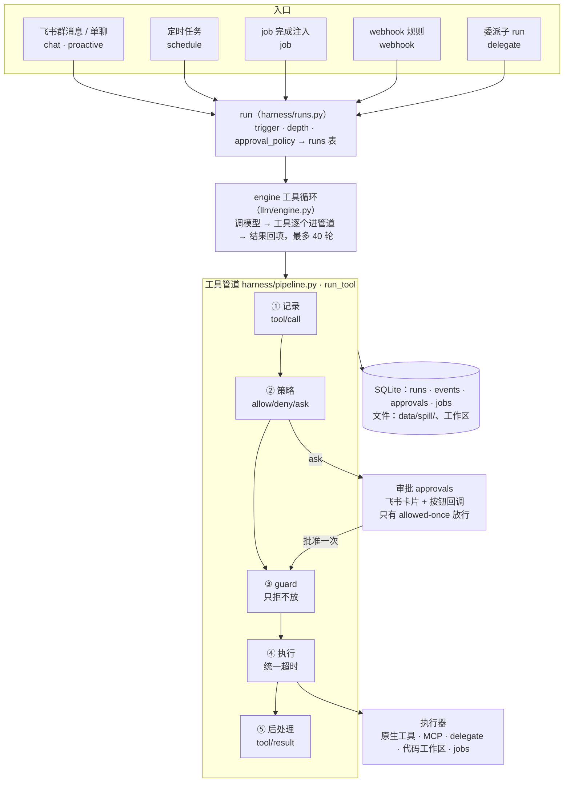

# feishu-agent harness 设计与路线

> 本文档是 harness 改造的依据，随实现同步更新。工程约定和坑见 [`CLAUDE.md`](../CLAUDE.md)。
> 最近更新：2026-10-22（P0、P1 已完成）。

## 1. 目标

**feishu-agent 本身就是 harness：一个长期在线的个人助手。** 它能听到事件、按时干活、安全地动手（运维操作、改代码）、懂我们的架构，把团队现在零散的需求都接住。漏洞监测只是它上面的一个场景，不是终点。

| 能力 | 含义 | 承载 |
|---|---|---|
| 听得到 | 群消息、单聊、定时、CI/ArgoCD/告警 webhook | 飞书长连接、调度器、`/hooks` |
| 记得住 | 对话、长期笔记、在做的事（任务状态）、按人的偏好 | `msgs` / `notes`、任务台账、个人记忆 |
| 懂架构 | k8s-fleet、k8s-ops、网络拓扑、CI/CD 怎么触发 | 技能（从 Git 同步 SKILL.md，和 Claude Code 共用） |
| 安全地动手 | 查、运维、改文档、改代码提 MR | 工具管道 + 策略 + guard + 审批 |
| 可审计 | 每一步做了什么、谁批准的 | `runs` / `events`、后台「运行记录」 |

**非目标**：不迁到 dsh 或其他框架（理由见附录 B）；不引入 asyncio 或多进程（守住 CLAUDE.md 坑 #2、#8）；飞书只出站、不开公网入站端口。

## 2. 当前进度

| 期 | 内容 | 状态 |
|---|---|---|
| P0 | `runs` / `events` 事件日志；后台「运行记录」页 | ✅ 已完成（d7898f0） |
| P1 | 工具执行管道 `run_tool()`；策略预设（兼容/只读/自定义）；guard（not_exposed、proactive、ssh_blacklist、k8s_precheck）；工具元数据 | ✅ 已完成（9ffa887） |
| P2 | 审批：飞书卡片回调、`approvals` 表、审批人、「审批」预设 | 进行中 |
| P2b | 技能从 Git 同步 | 待开始 |
| P2c | 自动审查预设（可选） | 待开始 |
| P3 | 代码工作区执行器 | 待开始 |
| P4 | 大输出外存 + `read_spill` | 待开始 |
| P5 | jobs、`inject()`、定时任务 collector 模式、webhook 规则 | 待开始 |
| P6 | 子 agent 委派 + 污染标记 / 污染 guard | 待开始，**读外部内容（CVE、舆情）前必须完成** |
| P7 | 个人助手：按人身份、记忆、权限 | 待开始 |
| 场景 | 漏洞台账与采集、日常运维、代码修复 | 建在内核之上 |

顺序原则：**先能审、再能批、再放权**。审批（P2）是放开写权限和改代码的前提；技能同步收益大、成本低，紧随其后。

## 3. 架构

审批不是捷径：批准之后仍要过 guard，任何人点「批准」都绕不开硬黑名单和污染规则。

### 3.1 包分层

`core` ← `harness` ← `feishu` / `obs` / `ops` / `sched` ← `llm` ← `web` ← `app`

`harness` 只依赖 `core`。需要上层能力时由上层反向注册：`ops/ssh.py`、`ops/k8s.py` 导入时 `policy.register_guard()`；`feishu/bot.py` 启动时 `approval.register_answerer()`（P2）。

| 模块 | 职责 | 状态 |
|---|---|---|
| `harness/runs.py` | run 生命周期、contextvar 传当前 run、启动清理、过期清理 | ✅ |
| `harness/pipeline.py` | `run_tool()` 五段管道、`ToolCall` | ✅ |
| `harness/policy.py` | 预设、规则匹配、guard 注册表 | ✅ |
| `harness/approval.py` | 审批请求、等待、落库、应答者注册 | P2 |
| `harness/skills.py` | 从 Git 同步技能 | P2b |
| `harness/workspace.py` | 代码工作区 | P3 |
| `harness/spill.py` | 大输出外存、`read_spill` | P4 |
| `harness/jobs.py` | 线程池、状态机、`inject()` | P5 |
| `llm/delegate.py` | `delegate` 工具（要调 `engine.run`，放 llm 层） | P6 |

## 4. 事件日志（P0，已实现）

一次 `engine.run` = 一个 run，写 `runs` 表；每一步作为事件只追加写入 `events`，后台「运行记录」页按时间线回放。

- **run 字段**：`id`、`app_id`、`chat_id`、`trigger`（chat / proactive / schedule / job / webhook / delegate）、`speaker_open_id`、`parent_run_id`、`depth`、`tainted`、`approval_policy`（chat=ask，其余=never）、`status`、`started`、`ended`、`total_tokens`。
- **状态**：`running`、`completed`、`silent`（旁听判定不发言）、`max-steps`（轮数用尽兜底）、`error`、`aborted`（进程重启时遗留的 running）。
- **事件类型（闭集）**：`run/start`、`user/message`、`assistant/message`（含 usage、是否兜底）、`tool/call`、`tool/decision`、`tool/result`、`run/end`。P2 起增加 `approval/asked`、`approval/decided`。
- **约束**：`tool/call` 先于执行写入；写事件是 best-effort，失败只打日志，不影响对话；调度线程每 6 小时清理 90 天前的记录。
- **不做**：不从 events 重建模型历史（`msgs` 仍负责对话记忆，两者并存）；不支持从中断点恢复 run。

## 5. 工具管道与策略（P1，已实现）

engine 里每次工具调用都走 `run_tool()`：

1. **记录**：写 `tool/call`（参数、风险等级）；参数从此冻结，执行器拿到深拷贝。
2. **策略**：`policy.decide(app.policy, tool, risk)`，规则自上而下第一条命中生效，一条都不命中=拒。
3. **guard**：只拒不放，任何一个给出理由就拒绝，策略的 allow 也推翻不了；guard 自身抛异常也按拒绝。
4. **执行**：独立线程 + 统一超时（`copy_context` 透传 contextvar，飞书文档工具靠它取本应用凭证）；异常归一为 `{"error": ...}`。
5. **后处理**：写 `tool/decision`、`tool/result`（状态 ok / error / denied、耗时、前 4000 字预览）。

被拒不会让整轮对话失败：模型拿到写明「被谁、为什么」的错误结果。

**工具元数据**（`llm/tools.py` 的 `_META`，只给宿主看）：`risk` 为 read / write / exec（`kubectl` 按动词判断），`timeout` 为管道超时。漏登记的工具按 exec 处理。MCP 工具按 write + 外部内容处理。

**预设**（`apps.policy`）：

| 预设 | read | write | exec | 用途 |
|---|---|---|---|---|
| 兼容（默认） | allow | allow | allow | 等于改造前行为，只叠加 guard |
| 只读 | allow | deny | deny | 情报类、旁听类应用 |
| 审批（P2） | allow | ask | ask | 运维、修复类应用 |
| 自定义 | — | — | — | JSON 规则：`tool`、`risk`、`decision` |

**guard**：

| guard | 规则 | 注册方 |
|---|---|---|
| `not_exposed` | 模型说出本应用没勾选的工具名 → 拒（修复了以前照样执行的漏洞） | harness |
| `proactive` | 旁听模式下拒 write / exec | harness |
| `ssh_blacklist` | `rm -rf /`、`mkfs`、`dd of=/dev/` 等不可逆命令 | `ops/ssh.py` |
| `k8s_precheck` | 只读集群拒非只读动词；`delete ns/pvc/node/--all` 等 | `ops/k8s.py` |
| 污染（P6） | 读过外部内容的 run 拒 exec，write 只放行台账类 | harness |
| 委派深度（P6） | depth > 2 拒 `delegate` | harness |

`ops` 的 `run()` 里保留同一个 `precheck()` 兜底，防止绕过管道直接调用。

## 6. 审批（P2，进行中）

策略判为 ask 时，发一张飞书卡片，**只有「批准一次」才执行**，其余结果一律拒绝（失败即拒绝）。

- **结果闭集**：`allowed-once`、`rejected`、`cancelled`、`unavailable`、`expired`。只有 `allowed-once` 放行，且只管这一次调用。没有应答者、卡片发送失败、超时、服务重启都不放行。
- **按触发方式定策略**：`chat` 默认 `ask`；`schedule`、`job`、`webhook`、`proactive` 为 `never`（ask 直接当拒绝，不发卡片）；`delegate` 固定 `never`。
- **等待方式**：工具线程在 `threading.Event` 上等，默认 10 分钟。飞书回调线程收到点击后写结果并 `set()`，3 秒内回应飞书。全程同步线程，不引入 asyncio。
- **落库与幂等**：`approvals` 表（id、run_id、call_id、app_id、chat_id、工具、参数摘要、理由、status、请求人、审批人、卡片 message_id、时间）。用 `UPDATE … WHERE status='pending'` 原子占位，多人同时点或连点只生效一次。服务启动时遗留的 pending 改为 `cancelled`。
- **谁能批**：`apps.approvers`（open_id 列表）。回调里校验点击人，不在名单就弹 toast 拒绝、卡片不变。名单为空时谁都批不了（ask 等于拒绝），避免误配成人人可批。默认不允许请求人批自己的 exec 调用。
- **卡片内容**：应用、触发人、工具、目标、完整参数、命中的规则；按钮「批准一次」「拒绝」，按钮 `value` 只放 `approval_id`。处理后卡片更新为最终状态和审批人。
- **飞书接线**：`_serve()` 的 `EventDispatcherHandler` 注册卡片回调 `card.action.trigger`（长连接）；开发者后台「事件与回调 → 回调配置」选长连接并订阅，改完需发版。`harness` 只定义 `approval.register_answerer(fn)`，由 `feishu/bot.py` 注册发卡片的实现。
- **审计**：每次审批写一对 `approval/asked`、`approval/decided` 事件，只进日志不进模型上下文。

**工具审批 ≠ 业务审批**：上面是短时、阻塞、属于某个 run 的工具审批。「合并修复 MR」这类可能等几小时的业务审批不占线程：run 结束时发一张带 `action_id` 的卡片，人点按钮后由注册好的 Python 函数确定性执行（调 GitLab API），不经过大模型。两者共用卡片回调入口、审批人校验和幂等，由 `approvals.kind` 区分。

### 6.1 自动审查（P2c，可选预设）

借鉴 dsh 0.2 的实验功能 Auto review：策略判为 ask 后、发人工卡片前，先让审查模型把调用评为三级。

| 等级 | 含义 | 处理 |
|---|---|---|
| low | 普通可逆操作，或只清理本 run 自己创建的对象 | 放行 |
| medium | 生产变更、不可逆删除、对外写入、安全配置变更 | 能找到人明确授权过这个动作、目标、范围时放行，否则回到 ask |
| high | 把敏感信息带出信任边界 | 一律拒绝 |

审查模型**只看**：固定审查策略、应用人设、人亲手写的话（带来源）、待执行调用。**看不到**工具结果、主模型输出和任何外部内容，所以已被注入的主模型说服不了它。输出严格 JSON，解析失败、超时一律按 deny。放行后仍要过 guard。每次审查写 `tool/review` 事件。

## 7. 技能从 Git 同步（P2b）

**架构知识只维护一份**：直接读公司 GitLab skill marketplace 里的 SKILL.md（`k8s-fleet`、`k8s-ops`、`fleet-network` 等），和 Claude Code 共用。

- 后台登记技能源：仓库地址、分支、只读 Deploy Token、子目录。
- 定时或手动同步：拉取后解析 SKILL.md 的 frontmatter（name、description）和正文，写入 `skills` 表，标注 `source=git`、提交号。Git 来源的技能在后台只读，改动走 MR。
- 引用文件（SKILL.md 里链接的其他 md）一并收进，`read_skill` 支持按路径读子文件。
- 同步失败保留上一版，不让技能突然消失。

## 8. 代码工作区执行器（P3）

让助手能真正改代码：在一次性工作区里 clone、修改、跑测试、出 diff，最后由确定性代码提 MR。

- **工作区**：每次在 `data/workspaces/<run_id>/` 新建，只读 clone 凭证；结束即删。后续可换成容器或 k8s Job 隔离。
- **两种实现**，按应用配置选：
  - **内置**：给专门的「工程师」应用开文件读写和受限 shell 工具，只作用于工作区目录，命令过 guard（禁网络外发、禁写工作区外路径）。
  - **dsh SDK**：把这一步委派给 dsh 编码子执行器（见附录 B）。dsh 不挂应答者，ask 一律拒；沙箱取 workspace-write。
- **结果可信**：diff 和测试结果由 harness 在工作区里重跑得出，不信任执行器自报的「测试通过」。
- **提 MR**：确定性代码推新分支、建 MR，再发业务审批卡片；执行器全程拿不到写权限凭证。
- **超时与取消**：默认 20 分钟，到时终止并返回 `aborted`。

## 9. 大输出外存（P4）

工具结果序列化后超过 6000 字符，整份存到 `data/spill/<app_id>/<run_id>/<spill_id>.txt`（0600），模型只拿首 2000 + 尾 1000 字符预览和 `spill_id`，需要时用 `read_spill(spill_id, offset/limit/grep)` 按需取。

- `read_spill` 由 engine 自动挂载，只能读本 run 和父 run 的 spill；单次返回同样受上限约束。
- 外存失败退回截断并标注，不把成功调用变成错误。
- 来自 external 工具的 spill 标为外部内容，读它同样污染 run。
- 保留 7 天；顺带去掉各工具自己的 `[:8000]` 截断。

## 10. jobs、注入与 webhook（P5）

- **jobs**：带状态机的线程池（`running / stopping / completed / killed / failed`），`kind` 为 `collector`（注册的 Python 函数，不过大模型）、`agent`（后台委派）、`scan`。按 `app_id` 授权；启动时遗留的 running 标 failed。模型侧工具 `start_job` / `job_status` / `job_output` / `cancel_job`。
- **注入**：`harness.inject(app_id, chat_id, text, trigger)` 是唯一的非群聊入口，以指定 trigger 启动一次 run。collector 只在「有新发现」时注入，无发现不花 token。
- **定时任务**：`schedules.mode` 为 `agent`（现行为）或 `collector`。
- **webhook**：`POST /hooks/{source}`，只对内网开放。每种来源（GitLab、ArgoCD、Harbor）有校验适配器，校验不过 401。**规则是受信代码**：`rule(delivery) -> InjectRequest | JobRequest | None`，写在仓库里、随版本发布，后台不能在线编辑；请求体永不直接交给模型。规则只转带校验过格式的字段时注入的 run 不标污染，转带自由文本必须声明 `tainted=True`。重复投递不去重，规则自己保证幂等。

## 11. 子 agent 与污染（P6）

- **委派**：`delegate(agent, task, input)` 在当前线程用目标应用自己的模型、工具、技能、策略跑子 run，不继承父级任何权限。子 run 用临时历史，不写群聊记忆；`output_schema` 通过 `submit_result` 工具拿结构化结果；非 `completed` 一律作为错误返回；`depth` 超过 2 拒绝。
- **子 run 审批固定 `never`**：不发卡片。可逆写操作由子应用策略放行或自动审查判 low 放行；不可逆操作以结构化待办返回父级或业务审批卡片。
- **污染**：`external` 工具成功返回即把 run 标为污染；污染 run 里 `exec` 一律拒，`write` 只允许台账类。父级污染时 `task` 自由文本不传给子级，改用目标应用的固定任务模板；`input` 必须按带 `pattern` / `enum` 的 schema 校验，校验不过不启动子 run。这样外部文本里的指令到不了有写权限的一端。

## 12. 个人助手（P7）

- **身份**：区分「谁在说话」。单聊即个人场景；群里按发言人。
- **个人记忆**：按人的偏好、常用集群和仓库、正在跟进的事，和应用级笔记分开。
- **个人权限**：审批人、可用工具按人细化（例如只有值班人能批 exec）。
- **任务台账**：「在做的事」有状态（打开 / 进行中 / 等待审批 / 完成），跨多次对话延续，助手能主动跟进。

## 13. 场景：漏洞监测

建在内核之上，不单独造轮子：

1. **台账与采集**（依赖 P5，不依赖模型）：`vulns`、`assets` 表；collector 拉 OSV、CISA KEV、EPSS、GitHub Advisory、NVD、Kubernetes CVE feed、Harbor 扫描结果，和资产比对，新的高危命中才注入。
2. **舆情加权**：Mastodon infosec.exchange、Bluesky、Reddit r/netsec、HN、厂商博客 RSS；X 官方 API 付费且价格多变，接入前确认。舆情只加权，不直接触发修复。
3. **分析与修复**（依赖 P2、P3、P6）：情报员（只读）→ 分析员（只读集群/日志/Harbor）→ 修复员（代码工作区出 diff，确定性代码提 MR，业务审批卡片合并）。

在 P6 之前，抓回来的外部内容只走确定性代码（入库、比对、推卡片），或交给完全不勾工具的应用写摘要。

## 14. 风险与待决问题

- **审批占线程**：每个等待中的审批占一个线程，最多 10 分钟；长等待一律走业务审批。
- **污染粒度粗**：整个 run 污染后关闭 exec，可能误伤；正确做法是拆角色。只读工具不受影响。
- **双写**：`msgs` 和 `events` 都存了消息，第一版接受冗余。
- **SQLite 写入量**：每次工具调用 4 到 5 次写入，WAL + 每线程连接下可接受，观察 `database is locked`。
- 待决：
  - [ ] lark-oapi 长连接是否支持 `card.action.trigger`，注册方法名是什么（P2 开工前验证）
  - [ ] 定时任务里的 ask 是否也发卡片等人（当前设计：直接拒绝）
  - [ ] 自动审查模型是否强制与主模型不同供应商
  - [ ] MCP server 默认算 external 是否太严（内部 server 可在后台标可信）
  - [ ] 代码工作区先用内置工具还是 dsh SDK

## 附录 A：dsh 参考要点

从 dsh（DeepSeek Harness，本地 `~/code/deepseek-harness`，0.2.1-rc.2）取「契约」不取「机制」：

| 能力 | dsh 的设计 | 我们取 |
|---|---|---|
| 工具管道 | `tool/call` 先落日志 → pre-execute（allow/deny/ask）→ 单调 guard → execute 包装 → post-execute → `tool/result`；参数不可改写 | 固定五段、参数冻结、异常归一 |
| guard | 只能 deny 或弃权，任何策略推翻不了 | 原样采用 |
| 审批 | 结果闭集，只有 `allowed-once` 放行；`asked/decided` 审计对；`ask/never` 策略；委派子会话固定 `never` | 全部采用 |
| 权限预设 | 沙箱模式 + 审批策略捆成具名预设 | 预设下拉框（无沙箱维度） |
| Auto review | 审查模型只看人写的话和待执行动作，排除工具结果和主模型输出 | 自动审查预设 |
| 子 agent | 新的扁平作用域，不继承权限；深度只增不减；`outputSchema`；非 completed 即错误 | 全部采用 |
| jobs | `kind-N` id、状态机、拥有者授权、`cancel` 幂等 | 状态机、授权、完成通知 |
| spill | 超长结果存起来，模型拿预览 + 定位符；存储失败保留原结果 | 全部采用 |
| webhook | 规则是受信代码，决定建会话或什么都不做 | 规则函数 |
| 事件日志 | 「模型看到的必须能从日志重建」 | events 表（暂不用它重建历史） |

## 附录 B：dsh Python SDK 评估

**结论**：不拿 dsh 当执行内核；可作为代码工作区执行器的一种实现。

- **形态**：每个 `DeepSeekHarness` 是一个 `dsh --profile sdk` 子进程，stdio JSON-RPC；Python 客户端是同步 threading；平台 wheel 分发（linux x64/arm64 manylinux_2_28）；MIT。
- **模型**：默认只注册 `deepseek-official`；挂 `llm-pi-ai` 后可声明 `api: openai-completions` + 自定义 `baseURL`，豆包等 OpenAI 兼容网关能接。一个进程一个模型。
- **限制**：协议只有 7 个客户端请求（initialize、prompt、resume、wait、工作目录读写、shutdown）；没有取消；Python 端不能注册工具（只能 profile 配置或 MCP）；服务端到客户端的请求「为未来审批预留」，目前无法从 Python 回答审批；开发者预览、无兼容承诺。
- **对比**：审批转飞书卡片、自有工具、trigger / 污染元数据都得写 TypeScript 插件，且要跟随快速变化的上游；而 dsh 现成的文件编辑、shell、工作区、沙箱正好是改代码要的。
- **接入前验证**：沙箱在 Linux 容器里的隔离效果；wheel 体积；豆包走 pi-ai 时工具调用与思考开关；能否用 patch 替换内置 coding persona。
- **重新评估时机**：SDK 协议支持审批应答、客户端注册工具和取消 run 之后。
