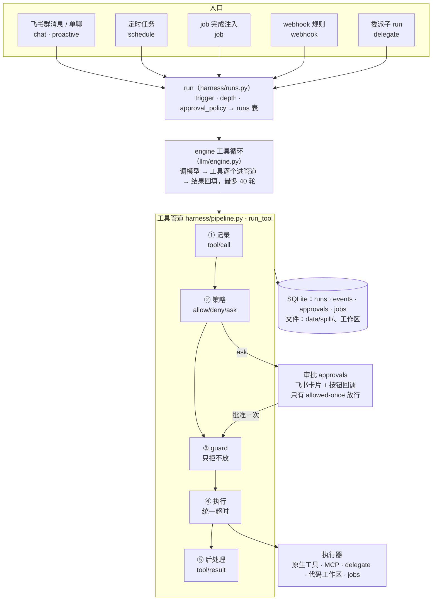

# feishu-agent harness 设计与路线

> 本文档是 harness 改造的依据，随实现同步更新。工程约定和坑见 [`CLAUDE.md`](../CLAUDE.md)。
> 最近更新：2026-10-22（已完成服务端持久任务、审批恢复、资源授权、本地沙箱验收和自主持续巡检；已做本地真实连接测试，尚未云部署）。
> 本文保留原 P0–P7 架构与路线；标为“规划”的机制不能当作现有能力。复现步骤见 [本地测试手册](local-harness-testing.md)。

## 1. 目标

**feishu-agent 本身就是 harness：一个长期在线的个人助手。** 它能听到事件、按时干活、安全地动手（运维操作、改代码）、懂我们的架构，把团队现在零散的需求都接住。漏洞监测只是它上面的一个场景，不是终点。

| 能力 | 含义 | 承载 |
|---|---|---|
| 听得到 | 群消息、单聊、定时、CI/ArgoCD/告警 webhook | 飞书长连接、调度器、`/hooks` |
| 记得住 | 对话、长期笔记、在做的事（任务状态）、按人的偏好 | `msgs` / `notes`、任务台账、个人记忆 |
| 懂架构 | k8s-fleet、k8s-ops、网络拓扑、CI/CD 怎么触发 | 技能（从 Git 同步 SKILL.md，和 Claude Code 共用） |
| 安全地动手 | 查、运维、改文档、改代码提 MR | 工具管道 + 策略 + guard + 审批 |
| 可审计 | 每一步做了什么、谁批准的 | `runs` / `events`、后台「运行记录」 |

**非目标**：不迁到 dsh 或其他框架（理由见附录 B）；不把工具内核改成 asyncio 或多进程（守住 CLAUDE.md 坑 #2、#8）。飞书连接主动出站；管理后台仍有 HTTP 端口，网络访问需单独限制。

## 2. 当前进度

本轮面向用户明确的三个场景：**集群管理、漏洞分析/修复、问题日志**。底座从“每条消息跑一次工具循环”改为“消息入持久任务队列，保存检查点并持续推进”。当前验收限本地：Python 3.12 自动测试、Docker 隔离测试、localhost 交互演示及真实服务测试。应用本身已通过飞书长连接、Kubernetes/ArgoCD、GitOps SSH、GitLab 项目与流水线 API 和 OpenObserve 完成只读扫描；飞书目标群及审批人绑定、真实 MR、漏洞资产匹配和云端部署尚未完成。

| 期 | 内容 | 状态 |
|---|---|---|
| P0 | runs/events 审计（历史提交 d7898f0） | 已有；本轮强化执行前关键记录失败即停止 |
| P1 | 工具管道（历史提交 9ffa887） | 已有；本轮默认 readonly、非法策略 deny、资源白名单、恢复时重新授权 |
| P2 | 飞书审批 | 已实现持久挂起、回调唤醒、过期与恢复检查；真实飞书回调待联调 |
| P2b | Git 技能同步 | 已有代码；内网 GitLab 联调待做 |
| P2c | 自动审查模型 | 规划，未实现 |
| P3 | 代码工作区与 MR | 已有并强化任务归属、全仓快照、测试/静态校验证据和未知结果处理；真实仓库克隆与静态校验已联调，实际 MR 待飞书审批验收 |
| P3 沙箱 | Docker 隔离测试 | 本地真实验证；默认禁用，云执行器拓扑待接入 |
| P4 | 大输出外存 / read_spill | 规划，未实现 |
| P5 底座 | tasks/task_actions/task_outbox、worker、租约、取消、检查点、定时原子入队 | 本轮已实现并本地验证 |
| P5 巡检 | patrol_monitors/scans/issues/outbox、来源覆盖率、租约、问题差异、飞书通知 | 本机真实验证；目标群未绑定，通知投递待验收 |
| P5 扩展 | 通用 jobs/collector/inject/webhook 规则体系 | 规划；入口幂等规范仍需逐一接入，不能等同于已实现持久任务 |
| P6 | 外部内容污染 / 子 agent | 污染 guard 与检查点已实现；通用委派尚未实现 |
| P7 | 身份、权限、在做的事 | 应用/用户/群限制、任务台账和上下文隔离已实现；按人的偏好与细化角色体系仍规划 |
| 场景 | 集群/日志/漏洞/研发工作流 | 提示与最低证据检查已实现；自动资产匹配、发布后验证/复扫闭环待做 |

### 2.1 当前执行契约

- 飞书消息、后台提交和定时计划进入 `tasks`；来源事件 ID 去重，同一应用/群串行。有界 worker 通过租约和 epoch 占有任务，模型回复/工具执行前后保存检查点。
- 独立的 `patrols` 由应用进程按配置运行，不依赖 Codex 在线。固定只读采集器查询集群、GitOps、GitLab 流水线与指定日志流；来源失败或覆盖不完整时不把旧问题误判恢复。扫描快照、问题差异和通知 outbox 在 SQLite 持久化；群绑定后首次扫描发送基线，后续变化才通知。
- 每个工具动作在 `task_actions` 固定工具、参数和审批。完成动作恢复时复用结果；当前权限仍需有效。非只读动作运行中丢失结果或超时进入 `needs_attention`，不自动重做副作用。
- `waiting_approval` 不占 worker；回调持久化决定后唤醒。`waiting_input` 等补充信息；`cancelled` 停止推进；通知进入 outbox 后独立重试。外部系统严格 exactly-once 不在当前保证内。
- `apps.policy` 空值默认为 readonly，非法配置 deny；`apps.resources` 缺失名单拒绝访问。管理员明确授予工具和资源，审批不能放宽硬限制。
- 上下文指纹绑定权限、工具、技能、MCP、模型配置等；变化后旧任务停下，须核对原任务并新建任务。“继续”不能把旧证据送到新权限或新供应商下；历史/新笔记按 app、chat 和指纹隔离。
- `code_test` 只有显式设置可信镜像和可用 Docker 执行器才运行；无宿主 shell 回退。全仓快照、测试命令、实际镜像 ID 绑定审批与测试证明。GitOps 仓库可用 `code_validate` 对当前快照做确定性 YAML/JSON 校验；相同快照通过相应校验后才允许提 MR。
- 当前主 Dockerfile/Compose 不含完整 Docker 执行器接线，云端需额外配置并验证。工作流的最低证据不等于生产恢复、资产受影响判断或修复发布验证。

顺序原则仍为：**先能审、再能批、再放权**。本轮优先补持久运行和权限边界，不把原路线的全部扩展宣称为已经完成。

## 3. 架构

下图保留原目标架构（含尚未实现的 job/webhook/delegate/spill）。当前入口先经过 `core/taskstore.py` 与 `harness/tasks.py`，再为一次执行尝试创建 run；完整现状以 §2 为准。

审批不是捷径：批准之后仍要过 guard，任何人点「批准」都绕不开硬黑名单和污染规则。

### 3.1 包分层

`core` ← `harness` ← `feishu` / `obs` / `ops` / `sched` ← `llm` ← `web` ← `app`

`harness` 只依赖 `core`。需要上层能力时由上层反向注册：`ops/ssh.py`、`ops/k8s.py` 导入时 `policy.register_guard()`；`feishu/bot.py` 启动时 `approval.register_answerer()`（P2）。

| 模块 | 职责 | 状态 |
|---|---|---|
| `core/taskstore.py` / `harness/tasks.py` | 任务、动作/outbox、租约、取消、恢复 | 本轮已实现 |
| `core/patrolstore.py` / `harness/patrols.py` | 应用自主巡检、扫描快照、问题差异、通知与恢复 | 本机真实验证 |
| `app/patrol_service.py` / `ops/cluster_scan.py` / `ops/gitops_scan.py` / `ops/log_scan.py` | 固定只读采集与飞书指令 | 本机真实验证；GitLab API 与群投递待补权限 |
| `harness/runs.py` | 每次尝试的 run、contextvar、审计与清理 | 已实现 |
| `harness/access.py` / `llm/authorization.py` | 资源白名单、当前授权、上下文指纹、目标固定 | 本轮已实现 |
| `harness/sandbox.py` / `harness/workflows.py` | Docker 隔离执行 / 最低业务证据检查 | 本轮已实现 |
| `harness/pipeline.py` | `run_tool()` 五段管道、`ToolCall` | ✅ |
| `harness/policy.py` | 预设、规则匹配、guard 注册表 | ✅ |
| `harness/approval.py` | 持久审批请求、挂起/唤醒、应答者注册 | 已实现，待真实飞书联调 |
| `harness/skills.py` | 从 Git 同步技能 | P2b |
| `harness/workspace.py` | 代码工作区 | P3 |
| `harness/spill.py` | 大输出外存、`read_spill` | P4 规划 |
| `harness/jobs.py` | 通用 job 类型与 `inject()` | P5 扩展规划；持久队列已由 tasks 实现 |
| `llm/delegate.py` | `delegate` 工具（要调 `engine.run`，放 llm 层） | P6 规划 |

## 4. 事件日志（P0，已实现）

一次 `engine.run` = 一个 run，写 `runs` 表；每一步作为事件只追加写入 `events`，后台「运行记录」页按时间线回放。

- **run 字段**：`id`、`app_id`、`chat_id`、`trigger`（chat / proactive / schedule / job / webhook / delegate）、`speaker_open_id`、`parent_run_id`、`depth`、`tainted`、`approval_policy`（普通任务允许 ask，proactive/delegate=never）、`status`、`started`、`ended`、`total_tokens`。
- **run 状态**：原有 running/completed/silent/max-steps/error/aborted，以及 waiting_approval/waiting_input/cancelled/needs_attention。跨尝试的任务状态存于 tasks，不能用 run 是否 aborted 推断整个任务已失败。
- **事件类型（闭集）**：`run/start`、`user/message`、`assistant/message`（含 usage、是否兜底）、`tool/call`、`tool/decision`、`tool/result`、`run/end`。P2 起增加 `approval/asked`、`approval/decided`。
- **约束**：`tool/call` 和动作意图先于执行落库，关键记录失败必须停止执行；结束审计可降级记录日志。旧记录清理机制保留。
- **恢复来源**：不从 events 重建模型历史；tasks.checkpoint 保存模型消息、待执行调用、证据和污染状态，task_actions 保存执行结果，恢复会创建新的 run。msgs 仍负责对话历史。

## 5. 工具管道与策略（P1，已实现）

engine 里每次工具调用都走 `run_tool()`：

1. **记录**：写 `tool/call`（参数、风险等级）；参数从此冻结，执行器拿到深拷贝。
2. **策略**：`policy.decide(app.policy, tool, risk)`，规则自上而下第一条命中生效，一条都不命中=拒。
3. **guard**：只拒不放，任何一个给出理由就拒绝，策略的 allow 也推翻不了；guard 自身抛异常也按拒绝。
4. **执行**：先校验当前租约、授权与快照并落 running，再在统一超时内执行（copy_context 透传上下文）；完成结果落动作账本。控制异常必须透传，非只读未知结果停止任务，不能一概转 error 后继续让模型重试。
5. **后处理**：写 `tool/decision`、`tool/result`（状态 ok / error / denied、耗时、前 4000 字预览）。

被拒不会让整轮对话失败：模型拿到写明「被谁、为什么」的错误结果。

**工具元数据**（`llm/tools.py` 的 `_META`，只给宿主看）：risk=read/local/write/exec、timeout、external 等；prepare/validate 固定并复查目标，preview 生成审批预览。漏登记按 exec。MCP 默认按 write + 外部内容处理，另须通过 server 资源授权。

**预设**（`apps.policy`）：

| 预设 | read | write | exec | 用途 |
|---|---|---|---|---|
| 兼容（显式选择） | allow | allow | allow | 历史兼容，仍叠加授权和 guard |
| 只读（默认） | allow | deny | deny | 空配置按此处理；local 也拒绝 |
| 拒绝 | deny | deny | deny | 非法配置按此处理 |
| 审批 | allow | ask | ask | local 允许；写/执行等待持久审批 |
| 自定义 | — | — | — | JSON 规则：`tool`、`risk`、`decision` |

**guard**：

| guard | 规则 | 注册方 |
|---|---|---|
| `not_exposed` | 模型说出本应用没勾选的工具名 → 拒（修复了以前照样执行的漏洞） | harness |
| `proactive` | 旁听模式下拒 write / exec | harness |
| `ssh_blacklist` | `rm -rf /`、`mkfs`、`dd of=/dev/` 等不可逆命令 | `ops/ssh.py` |
| `k8s_precheck` | 只读集群拒非只读动词；`delete ns/pvc/node/--all` 等 | `ops/k8s.py` |
| 污染（已实现） | 外部内容后的生产 write/exec 拒绝；例外仅隔离代码 local、沙箱测试、受审批 MR | harness |
| 委派深度（P6 规划） | 后续 delegate 不继承父权限并限制深度 | harness |

`ops` 的 `run()` 里保留同一个 `precheck()` 兜底，防止绕过管道直接调用。

## 6. 审批（P2，已实现持久恢复）

策略 ask 且 guard 允许后，绑定 `task_actions.approval_id`、保存审批并发卡。只有 `allowed-once` 放行，其余 rejected/cancelled/unavailable/expired 均不执行。无审批人、发卡失败不放行。飞书真实回调尚待联调。

- **等待**：任务保存 `waiting_approval` 后释放 worker；回调决定后 `tasks.wake()` 唤醒。支持回调早于挂起的竞态。没有 task 的 legacy 调用才保留线程阻塞兼容路径。
- **恢复**：审批批准后重新读取当前 app 权限、审批人、guard、固定参数及工作区快照；不是批准后直接执行。任务审批重启保留，启动仅取消无任务 legacy pending；默认过期时间 10 分钟。
- **幂等**：pending→终态原子更新；点击与恢复不能重复执行动作。未知执行结果停止人工核对。等待第二个审批时，历史已决定审批不能把任务反复唤醒。
- **触发**：chat/schedule/job/webhook 的普通任务可 ask；proactive/delegate 固定 never。
- **身份**：回调必须来自同一 app，审批人仍在名单，exec 不允许请求人自批；取消任务和过期审批不能复活动作。
- **卡片**：包含工具、固定参数、原因和 preview（代码测试/MR 含真实快照对应预览）。仅保存 approval_id 作为按钮动作标识。
- **飞书接线**：开发者后台长连接订阅 `card.action.trigger` 并发版；由 feishu/bot.py 注册应答器。内核只定义注册契约。

工具审批只授权一个固定动作，不代表业务已完成。MR 合并/发布后的业务审批与验证仍属后续闭环，当前不会自动合并 MR。

### 6.1 自动审查（P2c，历史规划，未实现）

借鉴 dsh 0.2 的实验功能 Auto review：策略判为 ask 后、发人工卡片前，先让审查模型把调用评为三级。

| 等级 | 含义 | 处理 |
|---|---|---|
| low | 普通可逆操作，或只清理本 run 自己创建的对象 | 放行 |
| medium | 生产变更、不可逆删除、对外写入、安全配置变更 | 能找到人明确授权过这个动作、目标、范围时放行，否则回到 ask |
| high | 把敏感信息带出信任边界 | 一律拒绝 |

审查模型**只看**：固定审查策略、应用人设、人亲手写的话（带来源）、待执行调用。**看不到**工具结果、主模型输出和任何外部内容，所以已被注入的主模型说服不了它。输出严格 JSON，解析失败、超时一律按 deny。放行后仍要过 guard。每次审查写 `tool/review` 事件。

## 7. 技能从 Git 同步（P2b，代码完成）

**架构知识只维护一份**：直接读公司 GitLab skill marketplace（`claude-skills` group）里的 SKILL.md（`k8s-fleet`、`k8s-ops`、`fleet-network` 等），和 Claude Code 共用。实现：`harness/skills.py`；表 `skill_sources`，`skills` 新增 `source_id / plugin / path / revision / files / synced`。

- **两种技能源**：`marketplace`（中央索引仓，读 `.claude-plugin/marketplace.json`，支持 `url`、`git-subdir`、索引仓内相对路径三种 source）和 `repo`（单个能力仓，可选子目录）。能力仓里仓根 `SKILL.md` 或 `skills/*/SKILL.md` 各算一个技能。
- **git 用 dulwich**（纯 Python，`requirements.txt`），镜像不装 git，避开构建机 apt 卡死；远程地址浅克隆。
- **认证**：只读 Deploy Token（scope 仅 `read_repository`）走 HTTPS basic auth。索引里的 `ssh://git@192.168.110.44:10022/` 按技能源的改写规则转成 `https://gitlab.layfz.com/`（同 git `insteadOf`）。
- **按名单同步**：`plugins` 名单为空=全部；敏感能力（如 `fleet-vpn`）不想给数字员工就不列。移出名单的技能下次同步删除。
- **安全**：令牌只发给与技能源同一主机的地址，索引里写了别的主机一律拒绝且不访问；索引相对路径、`git-subdir` 的 `path`、`subdir` 用 `../` 跳出克隆目录一律拒绝；符号链接（可能指向容器内任意文件）、二进制、超过 100KB 的文件不收；单技能附属文件总量上限 512KB；报告和错误里不出现令牌。
- **容错**：某个能力仓拉取失败，它的技能保留上一版（只有拉取成功且确认技能已不存在才删）；同名冲突（和手工技能或别的来源撞名）跳过并记录，不覆盖；更新保留技能 id，应用的勾选不丢。
- **触发**：调度线程每分钟检查一次，到期（默认 60 分钟、最短 5 分钟）的启用技能源另起线程同步，同步之间互斥；后台「立即同步」同步执行并返回报告。
- **使用**：`read_skill(name)` 返回正文和附属文件清单 `files`；`read_skill(name, file=…)` 读附属文件（如 `references/clusters.md`）。Git 来源的技能后台只读（编辑/删除返回 400），改动走能力仓 MR。

联调前提：服务所在机器能访问 `gitlab.layfz.com`（开发机外网不通，需在内网或部署后验证），并在 GitLab 给 `claude-skills` group 或相应能力仓建只读 Deploy Token。

## 8. 代码工作区执行器（P3，已强化；真实 GitLab 待联调）

保留原“本地工作区改动、确定性代码提 MR、人工评审合并”的架构。实现：harness/workspace.py、sandbox.py、gitutil.py；code_repos/workspaces/workspace_safety；后台代码仓库配置。

- 仓库登记 HTTPS 地址、默认分支、读令牌、项目级写令牌、固定测试命令或 GitOps 静态校验类型。令牌不放入模型上下文或工作区。
- 工具为 code_repos/open/list/read/search/edit/write/delete/diff/test/validate/propose_mr/close。工作区按应用、群和当前 task 归属；缺省只选当前任务工作区。容量满拒绝新建，不能删除正在使用的工作区来腾位置。
- local 为可逆的隔离工作区修改；code_test=exec，code_propose_mr=write。只读策略拒绝 local；审批策略允许 local，测试/MR 需审批。
- 路径、符号链接、.git 继续受限。审批固定全仓快照、命令和实际镜像 ID，执行前持工作区锁再验；差异变化不能沿用旧批准。
- code_test 使用独立不可变快照，默认禁用；显式 HARNESS_SANDBOX_IMAGE 选择已存在可信 Docker 镜像，不自动拉取，无宿主 shell 回退。无网络、非 root、只读根、限额、可写 tmpfs；不挂载服务数据/密钥/socket，依赖必须预装。
- 超时或取消确认销毁容器；无法确认停止标 uncertain。测试产物不回写仓库；通过记录绑定实际快照，改动后需重新测试。
- MR 要求当前快照的成功隔离测试，或 GitOps 仓库通过 YAML/JSON 静态校验；飞书审批卡片呈现完整 diff，过大则拒绝审批。由 GitLab API 建提交/分支/MR，不 git push。保存确定性分支和结果，成功后复用已有 MR；未知 API 结果停下核对，避免模型重复提交。
- 真实 Docker 隔离/超时/取消已在本机验收；主服务 Dockerfile 不含 Docker CLI，Compose 未接入云端沙箱。可信执行节点或 CLI/daemon 与一致宿主路径仍需部署设计与验证。

附录 B 的 dsh SDK 仍只保留为历史执行器评估，未接入。

## 9. 大输出外存（P4，历史规划，未实现）

工具结果序列化后超过 6000 字符，整份存到 `data/spill/<app_id>/<run_id>/<spill_id>.txt`（0600），模型只拿首 2000 + 尾 1000 字符预览和 `spill_id`，需要时用 `read_spill(spill_id, offset/limit/grep)` 按需取。

- `read_spill` 由 engine 自动挂载，只能读本 run 和父 run 的 spill；单次返回同样受上限约束。
- 外存失败退回截断并标注，不把成功调用变成错误。
- 来自 external 工具的 spill 标为外部内容，读它同样污染 run。
- 保留 7 天；顺带去掉各工具自己的 `[:8000]` 截断。

## 10. jobs、注入与 webhook（P5，扩展规划）

本节保留早期设想；当前持久任务由 tasks/task_actions/outbox 实现，不采用“重启直接失败”的内核。通用 collector/webhook 尚未交付，接入时须沿用来源事件去重，不能把下述“规则自己去重”当生产保证。

- **jobs**：带状态机的线程池（`running / stopping / completed / killed / failed`），`kind` 为 `collector`（注册的 Python 函数，不过大模型）、`agent`（后台委派）、`scan`。按 `app_id` 授权；启动时遗留的 running 标 failed。模型侧工具 `start_job` / `job_status` / `job_output` / `cancel_job`。
- **注入**：`harness.inject(app_id, chat_id, text, trigger)` 是唯一的非群聊入口，以指定 trigger 启动一次 run。collector 只在「有新发现」时注入，无发现不花 token。
- **定时任务**：`schedules.mode` 为 `agent`（现行为）或 `collector`。
- **webhook**：`POST /hooks/{source}`，只对内网开放。每种来源（GitLab、ArgoCD、Harbor）有校验适配器，校验不过 401。**规则是受信代码**：`rule(delivery) -> InjectRequest | JobRequest | None`，写在仓库里、随版本发布，后台不能在线编辑；请求体永不直接交给模型。规则只转带校验过格式的字段时注入的 run 不标污染，转带自由文本必须声明 `tainted=True`。重复投递不去重，规则自己保证幂等。

## 11. 子 agent 与污染（P6，委派仍为规划）

子 agent 契约为历史规划；污染标记/guard 已落地，准确规则见 §2 和 §5。下面的台账写例外、schema 委派过滤尚未实现，不是当前授权通道。

- **委派**：`delegate(agent, task, input)` 在当前线程用目标应用自己的模型、工具、技能、策略跑子 run，不继承父级任何权限。子 run 用临时历史，不写群聊记忆；`output_schema` 通过 `submit_result` 工具拿结构化结果；非 `completed` 一律作为错误返回；`depth` 超过 2 拒绝。
- **子 run 审批固定 `never`**：不发卡片。可逆写操作由子应用策略放行或自动审查判 low 放行；不可逆操作以结构化待办返回父级或业务审批卡片。
- **污染**：`external` 工具成功返回即把 run 标为污染；污染 run 里 `exec` 一律拒，`write` 只允许台账类。父级污染时 `task` 自由文本不传给子级，改用目标应用的固定任务模板；`input` 必须按带 `pattern` / `enum` 的 schema 校验，校验不过不启动子 run。这样外部文本里的指令到不了有写权限的一端。

## 12. 个人助手（P7，历史规划）

当前已经有发起人身份、可选用户/群权限、任务台账和按上下文隔离的历史/笔记；以下个人偏好、值班角色等更细体系仍待实现。

- **身份**：区分「谁在说话」。单聊即个人场景；群里按发言人。
- **个人记忆**：按人的偏好、常用集群和仓库、正在跟进的事，和应用级笔记分开。
- **个人权限**：审批人、可用工具按人细化（例如只有值班人能批 exec）。
- **任务台账**：「在做的事」有状态（打开 / 进行中 / 等待审批 / 完成），跨多次对话延续，助手能主动跟进。

## 13. 场景：漏洞监测（完整业务闭环规划）

当前已有漏洞查询、基础台账及 vulnerability 工作流；本节的连续多源 collector、资产自动匹配、角色链与发布复扫闭环尚未完成。演示只使用虚构漏洞，集成测试用外部替身，不能据此宣布真实资产已修复。

建在内核之上，不单独造轮子：

1. **台账与采集**（依赖 P5，不依赖模型）：`vulns`、`assets` 表；collector 拉 OSV、CISA KEV、EPSS、GitHub Advisory、NVD、Kubernetes CVE feed、Harbor 扫描结果，和资产比对，新的高危命中才注入。
2. **舆情加权**：Mastodon infosec.exchange、Bluesky、Reddit r/netsec、HN、厂商博客 RSS；X 官方 API 付费且价格多变，接入前确认。舆情只加权，不直接触发修复。
3. **分析与修复**（依赖 P2、P3、P6）：情报员（只读）→ 分析员（只读集群/日志/Harbor）→ 修复员（代码工作区出 diff，确定性代码提 MR，业务审批卡片合并）。

当前外部查询结果标为污染，生产执行/写入被限制；授权仓库中的隔离代码修改、测试和受审批 MR 可继续。后续多角色拆分仍须避免外部文本扩大权限。

## 14. 风险与待决问题

- **尚未部署/联调**：真实飞书卡片、生产只读集群与日志、公司 GitLab 权限和漏洞源需分阶段验证；目前成果不是生产上线验收。
- **结果不明**：网络中断时写操作可能已发生。动作账本提供停止和核对依据，不自动保证外部系统 exactly-once，也不提供通用回滚。
- **权限变化**：任务/记忆绑定配置指纹，变化后新建任务；不能为了方便恢复删掉检查点中的授权约束。
- **隔离与部署**：本机 Docker 测试已过，云端执行器与宿主权限仍待验证；主服务 Compose 不自动获得测试能力。
- **证据门槛**：有一次成功查询/测试/MR 是最低门槛，不能保证根因正确、资产完全覆盖、修复已发布。需要后续业务验收器。
- **规模与数据**：SQLite WAL 单实例、运行日志/检查点保存敏感信息；需备份恢复、保留策略、容量与负载验证。凭据可能存入 SQLite，并非自动加密。
- **仍待实现**：通用 collector/webhook、外存、委派、细化个人权限、自动复扫和业务审批闭环；自动审查模型不得作为隐含的现有能力。

## 附录 A：dsh 参考要点

从 dsh（DeepSeek Harness，本地 `~/code/deepseek-harness`，0.2.1-rc.2）取「契约」不取「机制」：

| 能力 | dsh 的设计 | 我们取 |
|---|---|---|
| 工具管道 | `tool/call` 先落日志 → pre-execute（allow/deny/ask）→ 单调 guard → execute 包装 → post-execute → `tool/result`；参数不可改写 | 固定五段、参数冻结、异常归一 |
| guard | 只能 deny 或弃权，任何策略推翻不了 | 原样采用 |
| 审批 | 结果闭集，只有 `allowed-once` 放行；`asked/decided` 审计对；`ask/never` 策略；委派子会话固定 `never` | 全部采用 |
| 权限预设 | 沙箱模式 + 审批策略捆成具名预设 | 预设下拉框；Docker 执行器须另行显式配置 |
| Auto review | 审查模型只看人写的话和待执行动作，排除工具结果和主模型输出 | 自动审查预设 |
| 子 agent | 新的扁平作用域，不继承权限；深度只增不减；`outputSchema`；非 completed 即错误 | 全部采用 |
| jobs | `kind-N` id、状态机、拥有者授权、`cancel` 幂等 | 状态机、授权、完成通知 |
| spill | 超长结果存起来，模型拿预览 + 定位符；存储失败保留原结果 | 全部采用 |
| webhook | 规则是受信代码，决定建会话或什么都不做 | 规则函数 |
| 事件日志 | 「模型看到的必须能从日志重建」 | events 表（暂不用它重建历史） |

## 附录 B：dsh Python SDK 评估

**结论**：不拿 dsh 当执行内核；可作为代码工作区执行器的一种实现。

- **形态**：每个 `DeepSeekHarness` 是一个 `dsh --profile sdk` 子进程，stdio JSON-RPC；Python 客户端是同步 threading；平台 wheel 分发（linux x64/arm64 manylinux_2_28）；MIT。
- **模型**：默认只注册 `deepseek-official`；挂 `llm-pi-ai` 后可声明 `api: openai-completions` + 自定义 `baseURL`，豆包等 OpenAI 兼容网关能接。一个进程一个模型。
- **限制**：协议只有 7 个客户端请求（initialize、prompt、resume、wait、工作目录读写、shutdown）；没有取消；Python 端不能注册工具（只能 profile 配置或 MCP）；服务端到客户端的请求「为未来审批预留」，目前无法从 Python 回答审批；开发者预览、无兼容承诺。
- **对比**：审批转飞书卡片、自有工具、trigger / 污染元数据都得写 TypeScript 插件，且要跟随快速变化的上游；而 dsh 现成的文件编辑、shell、工作区、沙箱正好是改代码要的。
- **接入前验证**：沙箱在 Linux 容器里的隔离效果；wheel 体积；豆包走 pi-ai 时工具调用与思考开关；能否用 patch 替换内置 coding persona。
- **重新评估时机**：SDK 协议支持审批应答、客户端注册工具和取消 run 之后。
