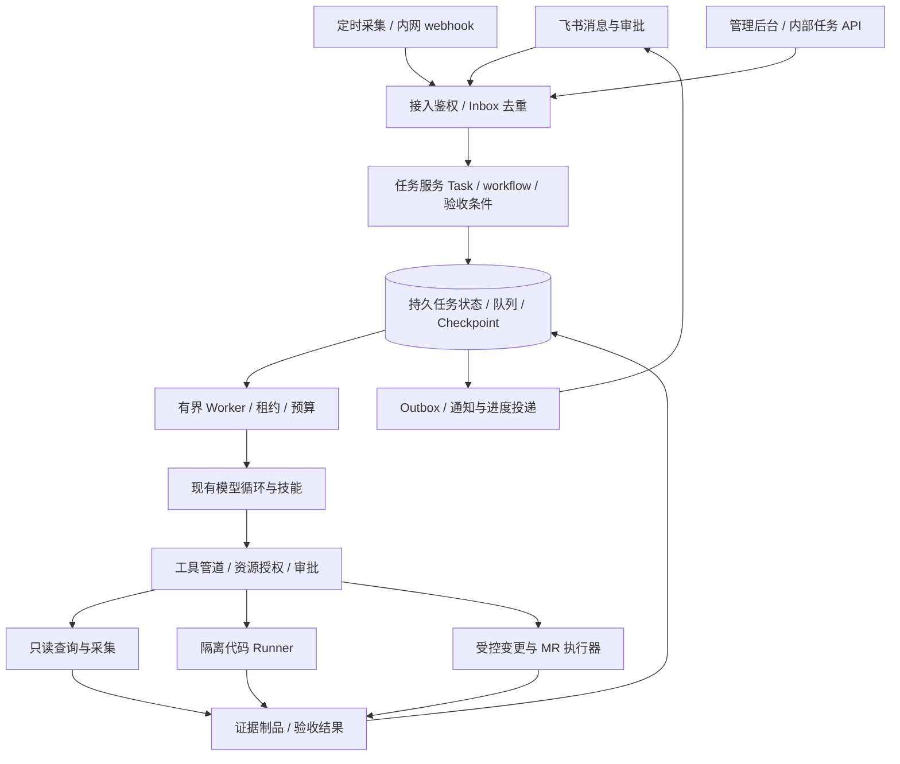

# 综合助手的服务端 harness 改造方案

评估日期：2026-10-22。代码基线：`fc2ecd9`。

> 实施状态：下文保留改造前的评估与目标。本轮已落地持久任务、动作账本、异步审批、恢复/取消、资源授权、上下文隔离、Docker 测试沙箱、管理后台任务中心及应用自主持续巡检。已完成本地自动测试、交互演示与真实飞书长连接、集群、GitOps、OpenObserve 只读联调。当前实现与复现步骤见 [本地验收手册](local-harness-testing.md)。尚未部署云端；GitLab API、目标群投递、漏洞资产匹配、完整业务闭环、独立远程 runner、多副本协调与通用 webhook 仍属后续工作。

本方案根据 `docs/harness-design.md`、`CLAUDE.md` 和实际源码核对形成。用户确认的目标是：**运维、漏洞跟踪、研发任务都能持续推进的综合助手**。本文是建议设计，不代表所列能力已经实现；现有 P2/P2b/P3 的真实环境联调状态仍以原文档为准。

## 1. 判断与目标

现有项目值得继续演进：飞书接入、工具执行管道、策略与审批、Git 技能、代码工作区、可观测连接和漏洞采集均可复用。当前执行单位主要是一次同步 `engine.run()`，服务端长期任务所需的接收确认、排队、恢复、等待、取消、重试与验收尚未形成统一契约。

目标执行单位应改成 **Task（用户交代的一件事）**。它可以跨多轮对话、多个 run、多人审批和服务重启；只有约定的交付条件满足才完成。模型输出一段回复只是一次 run 的结果。

例如：

- 运维任务：收到告警 → 查证影响范围 → 诊断 → 在授权范围内操作或等待审批 → 再检查服务 → 交付证据。
- 漏洞任务：定时采集 → 对照真实资产/依赖版本 → 判断是否受影响 → 建修复任务 → 跟踪 MR/发布 → 验证关闭。
- 研发任务：接受需求及验收条件 → 读仓库 → 隔离工作区修改/测试 → 提 MR → 按任务范围等待评审或交付。

三者共享内核，用不同 workflow 模板和 capability 配置。前端可以只有一个助手入口；执行身份和工具权限按任务类型、目标资源及人的授权收敛。

## 2. 代码中已经存在的关键差距

以下位置均相对于上述基线；不是线上故障结论。

| 问题 | 源码证据 | 对综合助手的影响 |
|---|---|---|
| 任务没有可靠交接 | `feishu/bot.py:425–456` 用内存集合去重后直接起 daemon thread；`sched/runner.py:40–42` 先推进下次时间再起线程 | 重启后去重失效；接收后崩溃或调度间隙崩溃可能漏执行 |
| run 不可恢复 | `harness/runs.py:63–78,104–109`；`app/main.py:62–70` | 重启将 running 标 aborted、pending 审批取消；无 checkpoint 续做 |
| 超时只停止等待 | `harness/pipeline.py:42–58,109–125` | 外部写操作可能继续成功，但模型收到普通 error，重试会造成重复副作用 |
| 审批未固定执行内容 | `harness/approval.py:56–77` 存 args、另算预览；`harness/workspace.py:402–424` 执行时重读文件 | 审批期间其他任务可改变工作区；省略 workspace 参数时，目标也可能变化 |
| 测试与控制面共享文件系统 | `harness/workspace.py:366–377` 在服务用户下运行 shell；`core/store.py:51–59,163–168` 存凭据 | 清理环境变量不构成沙箱；测试代码可能访问服务数据库和配置 |
| 策略错误可扩大权限 | `harness/policy.py:20–27,67–82` | 无效自定义规则/未知预设退回 compat，全放行已暴露工具 |
| 外部内容标记尚未成为执行限制 | `llm/tools.py:467–477` 已有 external 情报工具；`harness/pipeline.py:74–75` 仅记录，`policy.py:139–153` 无对应 guard | 与原设计“P6 前不得混用外部内容和执行权限”的要求不一致 |
| 应用开关尚未覆盖资源授权 | `llm/engine.py:232–234` 的 ctx 无 principal；`harness/workspace.py:58–72` 列全局仓库；`:91–100` 显式工作区只校验 app | 能调用某工具的应用可能访问全部已登记资源；同应用不同群缺少明确边界 |
| 同一会话可以并发改上下文 | `feishu/bot.py:454–456`；`llm/engine.py:220–223` | 多条消息可能读到同一旧历史，再交错保存；“最近工作区”容易串任务 |
| 运行记录不足以恢复完整输入 | `harness/pipeline.py:119–127` 仅保存 4000 字结果预览；`harness/runs.py:48–57` 落库 best-effort | 无法完整回放模型输入，也不能把事件日志直接当恢复引擎 |
| 完成状态缺少交付验收 | `llm/engine.py:244–250` 无 tool_calls 即 completed | 模型说完成与测试通过、服务恢复、漏洞消除不是同一个事实 |

本次用纯内存模拟执行器复现了三项行为：无效 custom 策略返回 allow；管道超时返回后执行器继续完成；external 工具结果之后 exec 仍可在 compat 下执行。未访问生产环境、读取运行时凭据或运行真实运维命令。

## 3. 目标架构与边界



- **接入层**只负责身份、事件去重、持久提交和响应；不在飞书回调里直接完成任务。
- **任务服务**持有“要完成什么、允许动什么、何时算完成”；只暴露授权后的状态与操作。
- **运行层**推进一个可恢复步骤；模型决定分析和计划，确定性代码负责权限、状态迁移、执行和验收。
- **执行层**区分只读 API、代码沙箱和生产变更。生产凭据不能进入代码沙箱。
- **交付层**提供报告、diff、测试记录、MR、服务验证结果。飞书消息是交付渠道之一。

保留现有同步 Python 风格、飞书长连接和管理后台。先做模块化单体；代码 runner 独立隔离。无需为了增加持久任务而同时重写所有工具、引入全套微服务或更换模型框架。

原文档“不引入多进程”的限制建议缩小为“飞书适配器暂不改事件循环模型”。执行沙箱与飞书客户端是不同边界，单个 SDK 的 loop 问题不应阻止执行隔离。此处是路线调整建议，尚未修改部署架构。

## 4. 把 Task 与 Run 分开

最小数据模型可渐进添加，不要求一口气实现所有表。

| 对象 | 职责与关键字段 |
|---|---|
| `tasks` | 长期目标：owner、project、workflow/version、授权范围、输入、acceptance、status、deadline、budget、parent_task_id |
| `runs` | 一次推进/尝试：task_id、attempt、触发方式、模型/提示词/技能/策略版本、token 与终态；保留现有 run 审计 |
| `task_steps` | 可恢复步骤：kind、state、input_ref、output_ref、checkpoint、错误类别、重试条件 |
| `inbox` | 已接收事件：source、event_id、app_id、身份、payload_ref、消费状态、唯一约束 |
| `jobs` | 可领取工作项：step_id、available_at、lease_owner、lease_until、lease_epoch、heartbeat、attempt |
| `actions` | 有副作用的动作：目标、参数快照、内容摘要、审批绑定、操作幂等键、远端结果 ID、outcome |
| `artifacts` | 完整日志、diff、报告和模型可见工具结果：owner/scope、URI、hash、size、trust、retention |
| `outbox` | 待投递通知：task_id、destination、dedupe_key、payload_ref、投递状态与重试时间 |

建议 Task 状态：

```text
queued → running → waiting_approval / waiting_input / waiting_external
                    ↓ 事件、审批或明确输入到达
                  queued → running → verifying → completed

可恢复失败 → retry_wait → queued
不可恢复失败 → failed
请求取消 → cancelling → cancelled（确认停止后）
外部副作用结果不明 → reconciling（或人工核对），不能直接当 failed 重跑
```

`run.completed` 只表示本次模型循环结束。`task.completed` 必须由 workflow 的验收器判断，写入可核对的结果。用户追加消息应关联明确 task_id；有多个活动任务时提示选择，不能仅用“本群最近工作区”猜测。

任务 API 可先提供 `submit/get/events/cancel/approve/resume`；提交返回 task_id。所有入口共用同一授权与提交路径，后台与 API 也不能绕过工具管道。

## 5. 持久执行最小契约

### 5.1 接收、领取与恢复

1. 飞书入口在一个数据库事务里写 inbox 与任务/待处理消息，再结束回调。唯一键包含 source、app_id、event_id；平台重投不会重复建任务。
2. 定时器在同一事务里写 `(schedule_id, scheduled_for)` 唯一工作项并推进 next_run；明确漏跑补偿和重叠策略。
3. worker 在短事务内原子领取任务，记录 lease 与递增 epoch。执行时不持有数据库长事务。
4. 全局、应用、资源都有并发上限；默认同一 session 的对话更新串行。同一任务/工作区只允许一个写入者。
5. 模型回复及 tool-call 列表在执行工具前持久化；每个工具结果持久化后，再进入下一步。恢复使用已存响应，不重新生成已经批准的动作。
6. worker 定期 heartbeat。租约过期可重新领取；旧 epoch 不得继续提交状态。每次 attempt 使用独立可写工作区，审批与 MR 使用不可变快照，避免旧 worker 失租后仍改动新 worker 使用的目录；runner 的领取与制品发布也校验 epoch。外部副作用还需要下游幂等/执行网关保护，数据库租约本身不能阻止已发出的 HTTP 请求。
7. 任务等待审批/输入/CI 时保存状态并释放 worker；事件到达后重新入队。重启后继续等待或按已存过期时间失效，不依赖内存 `Event`。

第一版单实例可以继续 SQLite，用事务和条件 UPDATE 领取工作项；限制 worker 数量，避免长事务。多实例之前应迁移共享数据库和领取机制，不能直接增加当前进程副本数。

如后续迁 PostgreSQL，可以用 `FOR UPDATE SKIP LOCKED` 避免多个 worker 争抢同一工作项；它适合队列表的领取，并不自动提供幂等和恢复语义。[PostgreSQL 官方说明](https://www.postgresql.org/docs/current/sql-select.html)

### 5.2 副作用与重试

不要承诺任意外部调用的 exactly-once。采用至少一次调度，加动作幂等、结果查证和明确的不确定态。

- 纯读取：满足 deadline 和次数预算时有限重试。
- 支持服务端幂等键的写入：使用持久 action_id 派生的稳定 key；重试不重新生成。
- 不支持幂等键的写入：保存可查询的远端关联标识，超时后先查证。
- 无法查询的任意 shell/SSH 副作用：结果不明则阻止自动重试，交给核对流程。
- 取消本地 runner：终止整个执行单元并确认退出；已经发往远端的请求需要独立核对。

MR 流程拆为 prepare → commit → create MR → verify。先持久化目标分支/action_id；若提交或 MR 已成功而响应丢失，按项目、分支及关联标识查询并续做，不能再次提交同一批变化。

通知也使用 outbox。支持时使用下游幂等标识；无法证明是否已投递时保留不确定状态。不要因发飞书消息失败而重跑整个研发或运维任务。

现有线程 join 超时只表示等待超时，Python 线程没有通用强制停止机制。[Python threading 官方说明](https://docs.python.org/3/library/threading.html)

### 5.3 关键落库必须成功

普通诊断日志可以 best-effort；任务接收、执行意图、审批消费和结果 checkpoint 必须成功保存。写失败时停止相应有副作用步骤。将关键状态与事件/outbox 写入同一事务。

恢复不能只依赖当前 events：完整结果另存 artifacts，checkpoint 引用它；保存实际消息、模型配置、工具 schema 与版本、技能 revision、策略版本。秘密用引用，日志和制品统一脱敏与授权。

## 6. 授权、审批与隔离

### 6.1 授权范围由宿主计算

引入执行上下文 `Principal + TaskScope + Capability`：人/系统触发身份、所属项目、允许的动作与资源、环境、审批条件、有效期。

有效权限取应用配置、调用者授权、任务范围与下游账号权限的交集。`tool=kubectl` 不等于允许操作所有集群；`code_open` 不等于允许打开所有仓库。资源的列举、读取、执行和制品下载都校验范围。

第一版至少实现 repo/host/cluster/namespace/文档空间 allowlist、工作区 task/session 归属，以及应用停用即时阻断新任务和后续受控动作。新应用默认只读或受控预设；无效策略拒绝执行。兼容模式只能显式选择，旧应用迁移需展示权限差异。

### 6.2 审批绑定不可变动作

在审批前执行 `prepare_action()`，解析所有默认参数和真实资源 ID，生成动作包：

```text
action_id + task_id + principal + tool/version
resource_ids + normalized_args + scope + policy_version
workspace_snapshot + base_commit + diff_hash + test_command
expires_at + approval_digest
```

审批卡展示动作目标、范围与制品。批准持久绑定 digest；执行前重新检查当前权限、应用启用状态、guard、动作版本与有效期。文件、目标或权限变化使旧批准失效。预览生成失败不能仍允许批准无法核对的变化。

审批消费与领取 action 原子进行；中断恢复沿用同一 action 幂等身份。不要把“按钮只能点一次”当成外部动作只执行一次。

### 6.3 代码执行沙箱

代码测试转到独立 runner，仅提供当前任务工作区与受控依赖缓存。无主服务数据库/config 挂载、无生产凭据、无宿主容器 socket、无特权模式。设置非 root 身份、文件/网络边界、CPU/内存/磁盘/进程数与时间上限。

依赖下载按仓库需要使用允许的出口或内部镜像源。把原始代码、完整执行输出和测试报告作为制品；提 MR 的写凭据只由控制面的受控执行器使用。runner 返回内容仍需验证：路径、符号链接、文件类型、体积及预期快照。

代码快照必须同时绑定测试结果和 MR：后续修改会使原测试证明失效。上传制品和运行测试不构成可信输入清洗。

### 6.4 外部内容与执行权限

外部公告、仓库文件、日志、文档、MCP 返回都可能包含不可信文本。“内部来源”也不能自动等同于指令可信。

先补来源/trust 标记和外部研究角色与生产执行角色的权限分离；在此之前禁止高权限应用混用未隔离的外部研究能力。研究结果转换成受约束的结构化提议，由确定性规则校验资源/范围和审批。

`tainted` 可以是保守 guard，不能被描述为完整防注入方案。schema、摘要、另一个模型或自动审查也不能赋予内容权威性。代码任务需要读取不可信仓库并运行测试，因此应允许明确授权的隔离沙箱执行，同时继续禁止直接获得生产命令权限。

子 agent 权限取目标角色配置与父任务委派范围的交集；父任务不能借委派扩大权限。高权限跨域执行必须经过单独授权的 action 流程。

## 7. 综合助手需要的上下文与工作记忆

拆分四种状态：

| 状态 | 内容 | 作用域 |
|---|---|---|
| 对话历史 | 用户输入、回复、当前交互关系 | session，遵守群/个人访问边界 |
| 任务工作记忆 | 目标、已证事实、计划、阻塞点、待验收项 | task；恢复时必需 |
| 个人偏好 | 语言、通知方式、常用项目 | user；不能跨群自动传播 |
| 团队知识 | 架构、SOP、技能、服务依赖关系 | project/team，带来源和版本 |

继续复用 Git skills 的渐进披露。将架构技能与实时资源清单关联：服务 → repo → pipeline → 镜像 digest → 部署环境 → 日志流 → 负责人。只把 CVE 名称与应用名称交给模型不足以判断影响；漏洞场景需要资产版本/SBOM/锁文件及匹配证据。

为每个 run 配置 token/时间/工具调用次数预算，为 Task 配置累计预算、最大重试次数和截止时间。达到限制进入明确的暂停/待处理状态，并交付已确认结果。

大结果先保存完整制品再提供摘要/定位符，按权限检索；摘要保留证据引用。上下文压缩不能丢失待执行动作、审批绑定和未确认事项。模型看过的具体内容应可从受控快照与制品重建。

## 8. 三个 workflow 的完成标准

| workflow | 自动推进边界 | 完成证据 |
|---|---|---|
| 运维排障 | 去重告警、读取监控/日志、形成假设与验证；在授权范围内执行受控动作，必要时等待审批 | 影响范围、诊断证据、执行记录、操作后的服务验证；没有恢复则不能报“已修复” |
| 漏洞跟踪 | 确定性采集与资产比对；仅在新风险/重要变化时建任务或通知；关联研发修复任务 | 受影响资产与版本依据、处置决定；“已修复”要求发布后的版本/扫描证据，不能只看 MR 创建 |
| 研发交付 | 明确需求与验收、准备工作区、修改、测试、提 MR；依据任务范围跟踪 CI/评审 | 绑定同一快照的 diff、测试/构建结果和 MR；若目标只是“提 MR”，交付到此即可，若目标是“上线”则需继续验证 |

运维、漏洞和研发之间通过 task 关联传递上下文：一个漏洞任务可以创建一个有独立授权和验收条件的研发子任务；子任务交付后父任务继续跟踪发布。不要把所有阶段塞入一个无限循环的对话。

后台增加“任务”主视图：目标、负责人、项目、状态、正在做什么、阻塞原因、累计成本、下一步、制品、审批、重试/取消。飞书支持查看任务、补充信息、审批与取消。提醒集中在有意义变化、完成、失败或需要人处理时；持续巡检无变化不刷屏。

## 9. 建议实施顺序与验收

下面用 H 编号，避免把建议阶段误写成原文档 P 阶段已完成。

| 阶段 | 交付范围 | 必须通过的验收 |
|---|---|---|
| H0 现有能力收口 | 策略 fail-closed、资源范围、外部内容边界、工作区归属、动作快照；代码执行隔离后启用测试能力；完成已有审批/GitLab 联调 | 非法策略不放行；跨群/跨资源拒绝；审批后内容变更不执行；测试不能读服务 DB/config；超时标不确定态且不盲重试 |
| H1 持久任务内核 | Task/step、Inbox、事务入队、有界 worker、checkpoint、恢复、取消、Outbox；先用只读诊断任务贯通 | 重复消息只建一个任务；接收/领取/结果提交边界崩溃可恢复；同会话不串上下文；发消息失败不重做任务 |
| H2 异步等待与制品 | 审批不占线程；artifact/spill；任务记忆与预算；动作幂等/结果查证；runner 受控取消 | 等待审批时重启可恢复；批准一次不产生重复副作用；MR 成功但响应丢失可核对；制品越权被拒；取消后执行单元确实退出 |
| H3 综合助手闭环 | 运维、漏洞、研发三个 workflow，共享任务后台；资产映射、子任务关联、CI/发布回执、验收器 | 三类真实样例各完整跑通；任务跨天持续；模型回复与业务完成分离；无新变化不通知；可核对全过程证据 |
| H4 按需求扩展 | 多 worker/数据库迁移、子 agent 并行、自动审查、个人偏好、工具分组发现 | 故障/重复投递/权限回归持续通过；委派不扩大权限；有可量化吞吐或体验收益 |

可并行推进 H0 与 H1 的只读路径；有副作用的恢复和自动执行必须等其安全、幂等契约就绪。每阶段小步迁移，旧 chat 入口可通过提交一个 Task 保留用户体验。

建议第一批改动拆成可独立审查的交付：

1. `harness/policy.py` 与资源授权上下文：坏配置拒绝；工具调用具备 principal/resource scope；补核心回归测试。
2. `core/store.py` 的版本化迁移与任务数据接口；新增 `harness/tasks.py`、`harness/queue.py`，先完成原子提交/领取和只读 worker。
3. `feishu/bot.py`、`sched/runner.py` 改为统一提交，新增 outbox 投递；模型循环通过 checkpoint 接口推进。
4. `harness/approval.py` 改为持久等待；新增动作准备/核对接口，工作区提 MR 使用快照。
5. `harness/workspace.py` 的测试委托给 runner；增加制品存取和任务后台，再接三个 workflow。

目录仍遵守单向依赖：harness 只依赖 core；模型运行、飞书发卡和具体执行器从上层注册。新增包同步更新 Dockerfile。

## 10. 框架与运维取舍

- **当前推荐**：保留 Python/FastAPI 和现有集成，单实例 SQLite 持久任务起步，独立代码 runner。先证明任务语义和三个流程闭环。
- **扩容条件**：多副本协调、积压、并发写或恢复时间出现明确要求时，再迁 PostgreSQL 与独立 worker。飞书长连接和 scheduler 要有明确单活/分片归属。
- **工作流框架**：若跨天等待、复杂并行、版本化恢复需求显著增长，再做 Temporal 等持久工作流方案的限定验证。它不能替代资源授权、沙箱或业务幂等；即使引入，其 Activity 仍需可安全重试。[Temporal Activity 官方说明](https://docs.temporal.io/activity-definition)
- **暂缓项**：自动审查、多 agent 自由协作、更多供应商适配均排在可靠执行之后。先用几个明确角色的 workflow 建立可验收行为。

服务健康至少分 liveness 与 readiness；后者覆盖数据库可用性、worker/scheduler 心跳与关键入口状态。记录队列等待、任务成功/恢复率、未决副作用、审批等待时长、成本和工具失败率。发布时停止领取、排空或 checkpoint 后退出；演练数据库与制品备份恢复。

依赖应固定到经过验证的版本，CI 加入关键契约和故障注入测试。现仓库未见可重复运行的测试文件，不能仅凭文档“测试通过”推断生产恢复与权限边界已经验证。

## 11. 对原设计文档的修订建议

1. 将 P5 从“线程池 + 重启标 failed”升级为持久任务、租约、恢复、异步等待和统一去重；去掉“webhook 不去重”的宿主契约。
2. 将 P7 的任务台账和身份/资源授权提前，个人偏好可后置。
3. 将 P6 的输入来源与权限隔离提前到外部情报和高权限工具混用之前；子 agent 功能可以后置。
4. 将 P3 的执行沙箱与审批动作快照作为放开代码测试/自动交付的前置条件。
5. 将 P4 的外存升级成带归属、完整性校验和证据引用的 artifact；与 checkpoint 一起设计。
6. 补上验收器与故障恢复标准；保留原 P0/P1 已完成结论，但明确事件审计与可恢复任务是不同能力。

本次仅新增评估方案，未修改现有功能、生产配置或原进度表。后续实现应按实际完成与联调证据更新两份文档。
